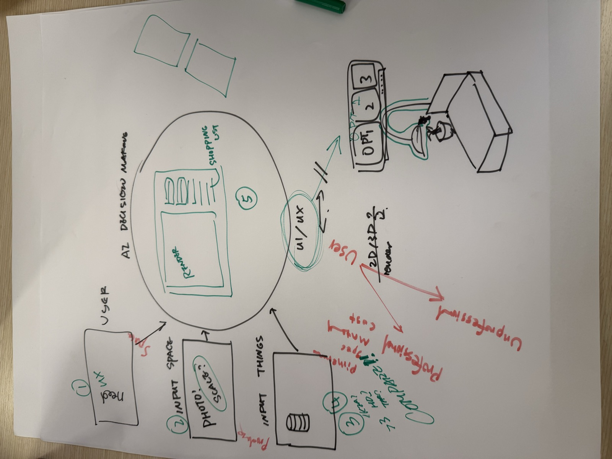
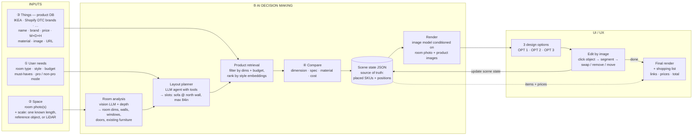

# The Elephant in the Room — AEC Hackathon NYC 2026

**AI furniture decision platform**

Tell us what you need, show us your room, and get a render of your space furnished with **real, buyable furniture** (real dimensions, real prices). Edit the design by clicking on the image, then leave with a **final render + shopping list**.



## Run the UI MVP

```bash
cp .env.example .env             # then paste your Gemini API key into .env (never commit it)
python3 server.py                # from the repo root (Windows: python server.py)
# open http://localhost:8000/app/
```

Plain HTML/CSS/JS reading `data/products.json`, plus `server.py` (Python standard library), which serves the app and calls Gemini. Four steps on one photo: **Needs (room photo + chat) → Design → Edit → Shop**. Room size is optional and folded away. Arrow keys move between steps.

- **Real:**
  - all 316 products, prices, dimensions, photos and colorways
  - the fit check against the wall width
  - the shopping list
  - **the render.** `server.py` sends the room photo and the white-background product photos to Gemini (`gemini-3.1-flash-image`, about 8 s and about $0.07 per image). Selecting an option renders it. After edits, click **Re-render**. **Before** toggles back to the original photo.
- **Real (furniture you already own):** in **Needs**, uploading a photo (or clicking *Find my furniture*) calls `/api/detect` (Gemini vision, boxes + category + estimated size). Each piece is cropped in the browser and sent to `/api/isolate`, which returns a **white-background isometric product shot**. The shots appear in the right-hand panel as they finish. **Keep** a piece and the planner designs around it (shown as "Yours · $0"; nothing of that type gets bought). **Ditch** it and the render removes it. Kept pieces can later be replaced with real products in Edit.
- **Mocked, to replace:** `planOptions()` in `app/app.js` stands in for the AI layout agent (P2). Room analysis is the user typing one wall length (P2). Pin positions are per-slot defaults; drag them onto the render.
- **Sketch Ideas (draw your furniture):** the white pen ball in the top-left corner (Needs, Design, Edit) opens a clean board. Draw rough shapes where you want pieces with the glowing white pen: a long box for a sofa, a tall line for a floor lamp, a blob up top for a pendant. Strokes drawn right after each other in the same spot join one shape. **Kitchen cabinets:** draw a straight line along a wall and it becomes a run of base cabinets. Its chip shows the length (type a new one in feet) and what the run costs. Each design option fills that length with real Home Depot modules (e.g. 36" + 36" + 36" for 9 ft), cheapest line for Essentials, priciest for Statement, and the modules go into the design, the shopping list and the render along your line. Naming a shape is optional: pick a type on its chip, tap **✦ Guess with AI**, or just press **Done** and each unnamed shape gets a free, instant guess from its size and place (no AI). Once a sketch is saved, the sketched pieces are **added to the generated design**, each a real product placed where you drew it at about the size you drew. A sketched piece of a type the design already has (e.g. a floor lamp) moves that piece to where you drew it instead of adding a second one. Live renders get a layout guide (the photo with the outlines labeled) so Gemini puts each piece inside its outline. Pieces only appear in the picture with AI renders on. **Remove sketch** in the Needs window goes back to the plain design. The AI guess uses Claude if `ANTHROPIC_API_KEY` is set, else Gemini (the render key, about a cent and ~10 s), else free shape rules; if an AI reader fails, the rules answer instead. Force one with `SKETCH_ENGINE=claude|gemini|rules` in `.env`.
- **Shopping list:** a left icon rail (from Design on) opens the list as its own column and pushes the room view aside (To buy / Keeping, total vs budget). **Expand** pushes the view off-screen and shows a full-page grid of everything in the room, with filters (All / To buy / Keeping / category). Clicking a card jumps to that piece in Edit. Deep link: `#step=3&cart=expanded`. **FF&E schedule** (in the list and in the grid) hands the room on in two files made from the same rows. **PDF** opens the print dialog on a designed sheet (the picture, the totals against the budget, one row per piece with its photo); choose "Save as PDF". No PDF library is used. **CSV** downloads `ffe-schedule.csv` in the 13 columns of a designer's FF&E schedule (Space, Room #, Item #, Item Description, Category, Qty, Unit, Spec / Notes, Vendor, Unit Cost, Total Cost, Drawing Ref, Status). Kept pieces are listed as "Existing, keep" with no cost.
- **Demo renders (default):** to save credits, renders show a saved image (`app/assets/demo-render-*.jpg`) instead of calling Gemini. Click **Demo renders · AI off** (top right) or open with `#live=1` to switch to real AI renders. Furniture detection and isometric shots still use the API but are cached.
- **Cost control:** identical requests are cached in `renders/cache/` (gitignored), so reloading or re-selecting an option is free.
- **Other commands:** `python3 server.py --test` renders a demo scene into `renders/`. `python3 server.py --models` lists the image models your key can use. Set `GEMINI_IMAGE_MODEL` in `.env` to switch models.
- **Example rooms:** two photos from the hackathon venue (`app/assets/example-lounge.jpg`, `example-bar.jpg`), switchable with *Next example*. The lounge photo is cropped so no one is identifiable.
- **Demo deep links:** `#step=2&sel=0` opens edit with the first item open. `#room=bedroom&step=3` opens the bedroom list. `#step=0&scan=1` scans the demo room. Add `&render=1` to render on load.

## Pitch deck

**https://elephant-pitch.vercel.app**. A scroll-driven pitch built from `deck/` (its own Vercel project, root directory `deck/`). See [`deck/README.md`](deck/README.md).

## Live site (Vercel)

Every push to `main` deploys automatically to production on Vercel. Teammates only need the link, no setup.
- The site is static (`app/`, `data/`) plus one Python function, `api/render.py`, which calls Gemini.
- `GEMINI_API_KEY`, `DEMO_PASSCODE` (and optionally `ANTHROPIC_API_KEY`) live in the Vercel project's environment variables, never in git.
- AI renders cost money, so the site asks for the **team passcode** once per browser. Ask in the team chat.

## Repo layout

| Path | What |
|---|---|
| `app/` | UI MVP (`index.html`, `style.css`, `app.js`, `sketch.js` = sketch furniture onto the photo) |
| `server.py` | Local dev server + `/api/render` → Gemini, `/api/sketch` → sketch reader (keys from `.env`) |
| `sketch_ai.py` | Reads sketched shapes → furniture types + sizes (Claude, Gemini or rules) |
| `api/` | Vercel functions (`render.py`, `detect.py`, `isolate.py`, `sketch.py`), `_core.py` = logic shared with `server.py` |
| `deck/` | Pitch deck (Vite + React), deployed to elephant-pitch.vercel.app |
| `vercel.json` | Vercel config: `/` → `/app/`, function timeout, bundled product images |
| `data/products.json` | 316 real IKEA products. See [`data/README.md`](data/README.md) and [`data/SUMMARY.md`](data/SUMMARY.md) |
| `data/images/` | White-background product photos for rendering |
| `schema/product.schema.json` | Shared product format |
| `scraper/` | Scrapers + merge script |

---

## The pipeline



### Key design principle: the render is derived from data, not the other way around

The image model never "invents" furniture. Every object in the render comes from a row in the **scene state**, which points to a real SKU. Edits change the scene state first, then we re-render. That way the shopping list always matches the picture, and every item is guaranteed to fit the room's dimensions.

```jsonc
// scene state (simplified)
{
  "room": { "width_in": 144, "depth_in": 120, "height_in": 96, "photo": "room.jpg" },
  "needs": { "style": "warm minimal", "budget_usd": 3000, "mode": "non-pro" },
  "items": [
    {
      "slot": "sofa", "sku": "ikea:80519531", "name": "KIVIK sofa",
      "price_usd": 1299, "dims_in": { "w": 89.375, "d": 37.375, "h": 32.625 },
      "placement": { "wall": "north", "offset_in": 20 },
      "bbox_in_render": [412, 530, 980, 810],
      "url": "https://www.ikea.com/us/en/p/kivik-sofa-grann-bomstad-black-80519531/"
    }
  ]
}
```

---

## Stage by stage

| # | Stage | Input → Output | How (MVP) | Stretch |
|---|---|---|---|---|
| ① | **User needs** | form + free text → `needs` JSON | Short form: room type, style chips, budget slider, must-haves; LLM normalizes free text | Style quiz from inspiration images; pro/non-pro modes (see below) |
| ② | **Input space** | room photo → room model with dims | Vision LLM extracts walls / windows / doors / existing items; user enters **one known length** (e.g. wall width) to set scale | Monocular depth model; iPhone LiDAR / RoomPlan scan; multi-photo |
| ③ | **Input things** | retailer sites → normalized product DB | Pre-scraped snapshot: IKEA (price + structured dimensions), Shopify brands via `/products.json` (Burrow, Floyd, Albany Park…) → SQLite/Postgres | More retailers (Home Depot, Target, Wayfair via third-party), image + text embeddings |
| ④ | **Compare** | candidate SKUs → comparison table | Side-by-side: dimensions, material, price; "fits / doesn't fit" badge | Reviews, delivery time, sustainability |
| ⑤ | **AI decision making** | needs + room + DB → scene state ×3 | LLM agent with tools: `search_products(filters)`, `check_fit(item, slot)`, `budget_left()` → 3 options | Clearance / circulation rules, pro mode constraint editor |
| — | **Render** | scene state + room photo → image | Image-editing model conditioned on room photo + product reference images | 3D view (2D vs 3D is an open question) |
| — | **Edit by image** | click on render → updated scene state | Click → segment the object → map to its scene item → show alternatives that fit the same slot → re-render | Drag to move, natural-language edits ("make it lighter") |
| — | **Output** | final scene state → render + list | Final image + shopping list (item, retailer, price, link, total) | Export PDF, share link, cart deep-links |

### Two kinds of users (from the sketch)

- **Non-professional:** guided flow, AI picks everything, simple swaps, pretty render.
- **Professional (designers):** exact dimensions, spec/material/cost compare tables, lock items, export lists.

MVP targets **non-professional**. Pro features are stretch goals.

---

## Work plan

### Team of 6: tracks and owners

| Person | Track | Owns | Deliverable |
|---|---|---|---|
| **P1** | A · Data | Stage ③ ④ | Scraper scripts + normalized product DB snapshot (~300 items, real dims + price + image) ✅ done: 316 items, search API, compare table data |
| **P2** | B1 · AI: space + decision | Stage ② ⑤ | Room analysis (photo → room JSON with scale), layout agent → 3 scene states |
| **P3** | B2 · AI: render + edit | Render, edit backend | Scene state → render, click → segment → map to item, re-render after swap |
| **P4** | C1 · Frontend: input | Stage ① ② UI | Needs form, photo upload + scale input, loading states |
| **P5** | C2 · Frontend: design + output | Options, edit UI, output | 3-option view, click-to-edit + alternatives panel, compare view, final render + shopping list |
| **P6** | D · PM / integration / demo | Glue + pitch | Owns `scene.schema.json` + mock data, end-to-end integration, demo rooms, script, slides, backup recording |

**Pairs that must sync often:** P1 ↔ P2 (search filters the agent needs), P3 ↔ P5 (edit loop), P2 ↔ P4 (room JSON format).

### Phases

| Phase | Goal | Done when |
|---|---|---|
| **0 · Setup** | Repo, stack, API keys, scene-state schema agreed | Everyone can run the app locally; `scene.schema.json` committed |
| **1 · Data** | Product DB snapshot | Query "sofa under $1500, width ≤ 85in" returns real items |
| **2 · Inputs** | Needs form + photo upload + scale | Uploading a photo produces a `room` JSON with dimensions |
| **3 · Decision** | Agent produces 3 scene states | All items fit the room and stay within budget |
| **4 · Render** | Scene state → image | 3 option renders that visibly contain the selected products |
| **5 · Edit loop** | Click → swap → re-render | One full swap round-trip works in the UI |
| **6 · Output + demo** | Shopping list, polish, pitch | End-to-end demo on 2 prepared rooms + backup video |

**Integration rule:** tracks talk only through the **scene-state JSON**. Freeze the schema in Phase 0 so frontend can build against mock data while AI and Data tracks work in parallel.

### MVP cut line

Must have for demo: ① → ② (manual scale) → ③ (pre-scraped DB) → ⑤ → render → one edit → output list.
Everything else is stretch.

---

## Open questions

- [ ] **Scale:** how to get real dimensions from a photo. Options: user enters one length, a reference object (door ≈ 80in), or a LiDAR scan.
- [ ] **2D vs 3D:** photoreal 2D render (faster, prettier) vs 3D scene (accurate, editable)?
- [ ] **Which retailers:** IKEA confirmed workable. Home Depot? Target? See data notes below.
- [ ] **Render model:** which image model best preserves real product appearance? Benchmark 2–3 in Phase 0.
- [ ] **Pro vs non-pro:** one product with two modes, or pick one audience?

## Data notes (researched 2026-11-14)

| Source | Price | Dimensions | Access |
|---|---|---|---|
| IKEA | ✅ | ✅ structured (width, depth, height, seat height) | Unofficial: site search endpoint + measurements JSON embedded in product pages |
| Shopify DTC (Burrow, Floyd, Albany Park, Maiden Home, Benchmade Modern) | ✅ | ⚠️ rarely in JSON; parse product pages | Public `/products.json` |
| Wayfair, RH, AllModern | via paid third-party scrapers | partial | No public catalog API |

These are unofficial sources and fine for a hackathon demo. **Snapshot the data ahead of time; don't scrape live during the demo.** Check each retailer's terms before turning this into a product.

## Conversational living brief (local branch)

The Needs step now starts with photo/context-led conversation. The designer is also available during Design/Edit/Shop. Confirmed requirements drive catalogue filtering, ranking and swap eligibility; see [implementation and validation notes](docs/living-brief.md).

`GEMINI_API_KEY` is required for real chat/photo analysis; `GEMINI_CHAT_MODEL` optionally selects the text/vision model. With no key the interface reports the missing connection; there is no sample fallback. Changes here are local until deployed.
