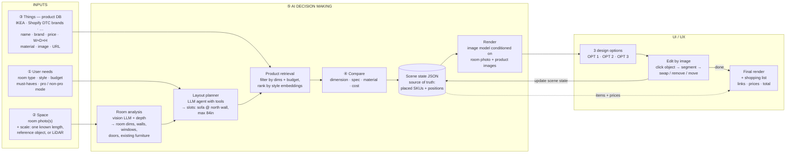

# Hackathon plan (AEC Hackathon NYC 2026)

The original plan the team worked from during the hackathon, moved here from the README unchanged. For what the product does now, see the [README](../README.md) and the pitch site, https://elephant-pitch.vercel.app.

## The planned pipeline

## Stage by stage

| # | Stage | Input → Output | How (MVP) | Stretch |
|---|---|---|---|---|
| ① | **User needs** | form + free text → `needs` JSON | Short form: room type, style chips, budget slider, must-haves; LLM normalizes free text | Style quiz from inspiration images; pro/non-pro modes (see below) |
| ② | **Input space** | room photo → room model with dims | Vision LLM extracts walls / windows / doors / existing items; user enters **one known length** (e.g. wall width) to set scale | Monocular depth model; iPhone LiDAR / RoomPlan scan; multi-photo |
| ③ | **Input things** | retailer sites → normalized product DB | Pre-scraped snapshot: IKEA (price + structured dimensions), Shopify brands via `/products.json` (Burrow, Floyd, Albany Park…) → SQLite/Postgres | More retailers (Home Depot, Target, Wayfair via third-party), image + text embeddings |
| ④ | **Compare** | candidate SKUs → comparison table | Side-by-side: dimensions, material, price; "fits / doesn't fit" badge | Reviews, delivery time, sustainability |
| ⑤ | **AI decision making** | needs + room + DB → scene state ×3 | LLM agent with tools: `search_products(filters)`, `check_fit(item, slot)`, `budget_left()` → 3 options | Clearance / circulation rules, pro mode constraint editor |
| — | **Render** | scene state + room photo → image | Image-editing model conditioned on room photo + product reference images | 3D view (2D vs 3D is an open question) |
| — | **Edit by image** | click on render → updated scene state | Click → segment the object → map to its scene item → show alternatives that fit the same slot → re-render | Drag to move, natural-language edits ("make it lighter") |
| — | **Output** | final scene state → render + list | Final image + shopping list (item, retailer, price, link, total) | Export PDF, share link, cart deep-links |

### Two kinds of users (from the sketch)

- **Non-professional:** guided flow, AI picks everything, simple swaps, pretty render.
- **Professional (designers):** exact dimensions, spec/material/cost compare tables, lock items, export lists.

MVP targets **non-professional**. Pro features are stretch goals.

---

## Work plan

### Team of 6: tracks and owners

| Person | Track | Owns | Deliverable |
|---|---|---|---|
| **P1** | A · Data | Stage ③ ④ | Scraper scripts + normalized product DB snapshot (~300 items, real dims + price + image) ✅ done: 316 items, search API, compare table data |
| **P2** | B1 · AI: space + decision | Stage ② ⑤ | Room analysis (photo → room JSON with scale), layout agent → 3 scene states |
| **P3** | B2 · AI: render + edit | Render, edit backend | Scene state → render, click → segment → map to item, re-render after swap |
| **P4** | C1 · Frontend: input | Stage ① ② UI | Needs form, photo upload + scale input, loading states |
| **P5** | C2 · Frontend: design + output | Options, edit UI, output | 3-option view, click-to-edit + alternatives panel, compare view, final render + shopping list |
| **P6** | D · PM / integration / demo | Glue + pitch | Owns `scene.schema.json` + mock data, end-to-end integration, demo rooms, script, slides, backup recording |

**Pairs that must sync often:** P1 ↔ P2 (search filters the agent needs), P3 ↔ P5 (edit loop), P2 ↔ P4 (room JSON format).

### Phases

| Phase | Goal | Done when |
|---|---|---|
| **0 · Setup** | Repo, stack, API keys, scene-state schema agreed | Everyone can run the app locally; `scene.schema.json` committed |
| **1 · Data** | Product DB snapshot | Query "sofa under $1500, width ≤ 85in" returns real items |
| **2 · Inputs** | Needs form + photo upload + scale | Uploading a photo produces a `room` JSON with dimensions |
| **3 · Decision** | Agent produces 3 scene states | All items fit the room and stay within budget |
| **4 · Render** | Scene state → image | 3 option renders that visibly contain the selected products |
| **5 · Edit loop** | Click → swap → re-render | One full swap round-trip works in the UI |
| **6 · Output + demo** | Shopping list, polish, pitch | End-to-end demo on 2 prepared rooms + backup video |

**Integration rule:** tracks talk only through the **scene-state JSON**. Freeze the schema in Phase 0 so frontend can build against mock data while AI and Data tracks work in parallel.

### MVP cut line

Must have for demo: ① → ② (manual scale) → ③ (pre-scraped DB) → ⑤ → render → one edit → output list.
Everything else is stretch.

---

## Open questions

- [ ] **Scale:** how to get real dimensions from a photo. Options: user enters one length, a reference object (door ≈ 80in), or a LiDAR scan.
- [ ] **2D vs 3D:** photoreal 2D render (faster, prettier) vs 3D scene (accurate, editable)?
- [ ] **Which retailers:** IKEA confirmed workable. Home Depot? Target? See data notes below.
- [ ] **Render model:** which image model best preserves real product appearance? Benchmark 2–3 in Phase 0.
- [ ] **Pro vs non-pro:** one product with two modes, or pick one audience?

## Data notes (researched 2026-11-14)

| Source | Price | Dimensions | Access |
|---|---|---|---|
| IKEA | ✅ | ✅ structured (width, depth, height, seat height) | Unofficial: site search endpoint + measurements JSON embedded in product pages |
| Shopify DTC (Burrow, Floyd, Albany Park, Maiden Home, Benchmade Modern) | ✅ | ⚠️ rarely in JSON; parse product pages | Public `/products.json` |
| Wayfair, RH, AllModern | via paid third-party scrapers | partial | No public catalog API |

These are unofficial sources and fine for a hackathon demo. **Snapshot the data ahead of time; don't scrape live during the demo.** Check each retailer's terms before turning this into a product.
